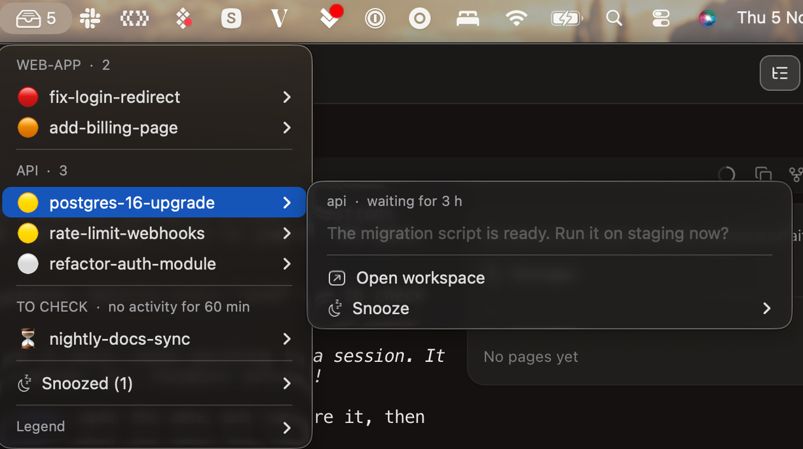

# attention-radar

A macOS menu bar inbox of the Claude Code sessions in [Paradev](https://superset.sh) (formerly Superset) that are waiting for you.



## Why

With ten worktrees open, the Paradev sidebar shows a lot of sessions as idle. Some of them really wait for an answer from you. Others look idle but are waiting on a background subagent, a shell, a `Monitor`, a scheduled wakeup or another agent. You can only tell them apart by opening each one.

attention-radar reads each session's state and keeps only the ones where the next move is yours. The number in the menu bar is how many there are. The goal is inbox zero. A row stays until the session runs again, even after you've looked at it.

## What it counts

A Claude Code session running in a Paradev terminal counts unless something is still running:

| Signal | Source | Effect |
|---|---|---|
| Open dialog: Paradev `blocked`, status `waiting`, or an unanswered `AskUserQuestion` or plan approval | snapshot, session file, transcript | 🔴 top of the list, even if the session is otherwise busy |
| Last turn failed | Paradev `host.db` | 🔴 top of the list |
| Status `busy` (thinking, tool, background subagent) or `shell` (background shell, `Monitor`) | `~/.claude/sessions/<pid>.json` | Hidden |
| Status `shell`, but the turn ended on a question, or every background shell is a server listening on a TCP port | transcript, `ps` and `lsof` | Counted: a dev server never ends, so the session is waiting for you |
| `ScheduleWakeup` or one-shot cron still to come | transcript | Hidden |
| Recurring cron not deleted | transcript | Hidden |
| Orchestrator whose worker is still running, with no unread report (opt-in, see below) | orchestrator records | Hidden |
| Anything else | | Counted, oldest first |
| Terminal gone but the session never closed (shutdown, crash) | Paradev `host.db` | ↻ "Interrupted" at the top, counted, with **Resume** |

Rows are grouped by project. The dot shows how long a session has been waiting: 🟠 under 1 h, 🟡 1 to 24 h, ⚪ over 24 h (probably finished: delete the workspace).

A hidden session that has shown no activity for 60 minutes moves to "To check" at the bottom of the menu, without raising the count. That catches a stuck shell or a subagent that hung.

A session that ended its turn on "I'm waiting for X" with nothing running does count. No local signal separates it from a real question.

## Using it

- Hover a row to open its workspace or snooze it.
- Click a row to open its workspace in Paradev, on the right pane.
- A row you opened moves to the end of its group until the session writes again, so you don't open it twice while the radar catches up.
- Hover, then **Snooze**: 1 h, 2 h, until noon or 18:00, or tomorrow morning. New activity in the session brings it back sooner.
- After a shutdown or a crash, the sessions that were open show under **Interrupted**. Click one to resume it in its workspace on the same conversation (`paradev agents create --resume-session`), or **Resume all** to bring them back one every two seconds. A row leaves once a live terminal holds its session again.
- **Focus on a project**, then a duration: only that project shows and counts in the menu bar; the others fold into one "Other projects" submenu until the focus ends or you stop it.
- **Ignore a project**, then a duration: the opposite of focus. That project leaves the list and the count, and waits in an "Ignored projects" submenu until the time is up or you pick **Stop ignoring**. Several projects can be ignored at once. To skip a project for good, use `ignore_projects` in the config.
- `!` in the menu bar means the radar is broken. It never shows zero in that case.

The menu never deletes a workspace and never types into a session. Resume is the one thing it starts: a Claude on a conversation that already existed, and only when you click it.

## Install

You need macOS, Paradev with Claude Code in its terminals, and [SwiftBar](https://swiftbar.app). The radar uses the Python 3 that ships with macOS and has no dependencies.

```bash
brew install --cask swiftbar
git clone https://github.com/JimmyDore/attention-radar.git
cd attention-radar
./install.sh
```

`install.sh` links the plugin into SwiftBar's plugin folder, setting one up if SwiftBar has none. It then runs `doctor`, which prints what the radar can see:

```
config file      ~/.config/attention-radar/config.json (not found, defaults)
paradev cli      ~/.paradev/bin/paradev
claude dir       ~/.claude
host databases   ~/.paradev/host/…/host.db
orchestrators    off
snooze file      ~/.local/state/attention-radar/snoozes.json
agent terminals  12, 12 linked to a Claude session
```

To update, run `git pull`. The plugin is a link, so there's nothing to reinstall.

The menu refreshes every 10 seconds. To change that, rename the link in the plugin folder, for example to `attention-radar.30s.py`.

## Configuration

Everything has a default. To change something, create `~/.config/attention-radar/config.json` with the keys you want ([config.example.json](config.example.json) lists them all):

```json
{
  "language": "fr",
  "stale_after_minutes": 30,
  "ignore_projects": ["sandbox"]
}
```

| Key | Default | What it does |
|---|---|---|
| `language` | `"en"` | Menu language: `en` or `fr` |
| `stale_after_minutes` | `60` | How long a running session can stay silent before it goes to "To check" |
| `morning_hour` | `9` | When "Snooze until tomorrow" ends |
| `snooze_hours` | `[12, 18]` | Times offered as "Until …" in the snooze menu |
| `ignore_projects` | `[]` | Paradev project names the radar skips |
| `paradev_cli` | found automatically | Path to the `paradev` CLI |
| `claude_dir` | `$CLAUDE_CONFIG_DIR` or `~/.claude` | Where Claude Code keeps its sessions and transcripts |
| `host_dbs` | `~/.paradev/host/*/host.db`, `~/.superset/host/*/host.db` | Paradev host databases, read for failed turns and interrupted sessions |
| `orchestrators_dir` | off | See below |
| `demo` | `false` | Show made-up sessions instead of yours, for screenshots |

An unknown key or broken JSON shows `!` in the menu bar with the reason, so a typo can't fail silently.

### Orchestrators (optional)

If one session dispatches work to sessions in other workspaces and waits for them, it shows as waiting for you while the workers run. Point `orchestrators_dir` at a folder that describes who reports to whom, and the radar hides the orchestrator while one of its workers is running and none of its reports is unread:

```
<orchestrators_dir>/
  <topic>/
    orchestrator.json     {"terminal": "<the orchestrator's Paradev terminal id>"}
    workers/<any>.json    {"workspace": "<a worker's Paradev workspace id>"}
    inbox/<any>.json      one file per report the orchestrator has not read yet
```

Your orchestration tooling writes these files. The radar only reads them.

## Limits

- `~/.claude/sessions` and `host.db` are internal formats, so an update to Claude Code or Paradev can break the radar. If no session matches at all, the menu bar shows `!` instead of zero.
- Sessions are matched to terminals through the terminal id that Paradev puts in its environment (`SUPERSET_TERMINAL_ID` today), so only Claude Code started in a Paradev terminal is counted.
- A workspace without Claude running isn't counted, so a Claude you exit before it finishes drops off the radar. Sessions killed with their terminal (shutdown, crash) are the exception: they show as Interrupted.

## Privacy

The radar runs locally and makes no network calls. It reads the Paradev CLI's snapshot, Paradev's host database, Claude Code's session files, the end of each transcript, and the process list and listening ports (`ps`, `lsof`) when a session has a background shell. It writes only its own state files (snoozes, opened rows, focus), and starts a Claude only when you click Resume.

## Development

```bash
/usr/bin/python3 -B -m unittest discover -s tests
/usr/bin/python3 -B attention_radar.py demo      # the menu SwiftBar would draw, with made-up sessions
/usr/bin/python3 -B attention_radar.py           # the same with your real sessions
```

## License

MIT
